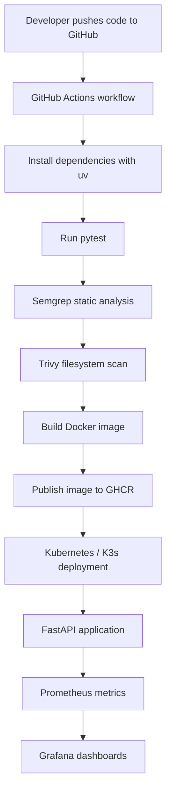
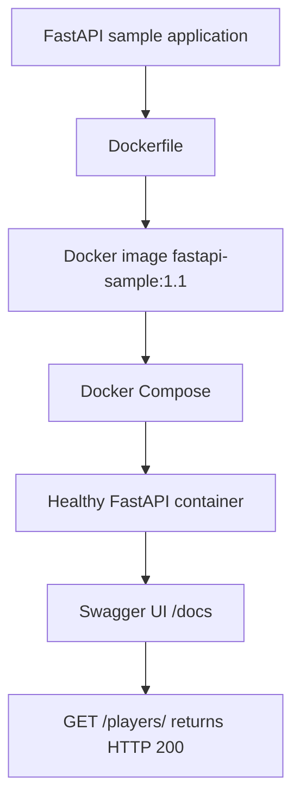

# Platform Architecture

## Intended end-to-end architecture

## Verified local deployment path

## Infrastructure as Code
Terraform currently configures the AWS provider for region `ap-southeast-2` and reads the active region as a data source. No AWS resources are declared or provisioned by the current configuration.

## Status note
The first diagram describes the target architecture, not a fully deployed system. The second diagram describes the local path that has been verified. GHCR, Kubernetes / K3s, Prometheus, and Grafana remain planned implementation work.
